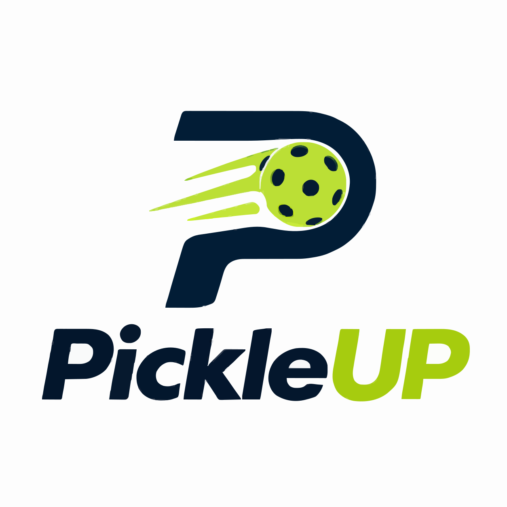
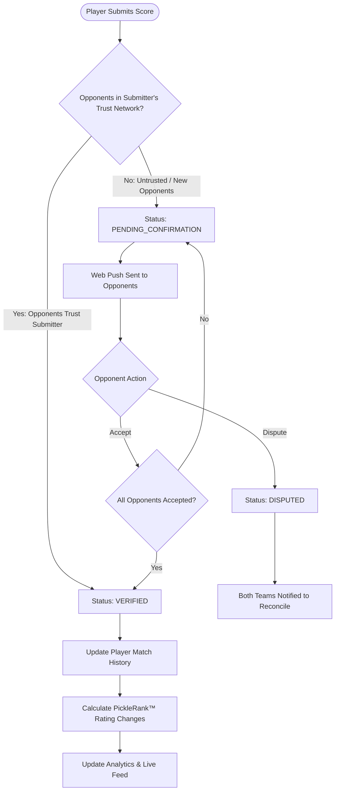

<p align="center">
  
</p>

<h1 align="center">PickleUP</h1>

<p align="center">
  <strong>Play &bull; Score &bull; Verify &bull; Track &bull; Compete &bull; Improve</strong>
</p>

<p align="center">
  A high-performance, mobile-first Progressive Web App (PWA) engineered for recreational pickleball players, local clubs, and competitive leagues. Log match scores in seconds, build verifiable match histories with peer confirmation and mutual trust, track Elo-adapted player ratings with <strong>PickleRank&trade;</strong>, and uncover deep performance analytics&mdash;all built on a zero-cost, fully portable cloud architecture.
</p>

<p align="center">
  <a href="https://react.dev/"></a>
  <a href="https://www.typescriptlang.org/"></a>
  <a href="https://vite.dev/"></a>
  <a href="https://tailwindcss.com/"></a>
  <a href="https://supabase.com/"></a>
  <a href="https://developer.mozilla.org/en-US/docs/Web/Progressive_web_apps"></a>
  <a href="./GAME_RULES.md"></a>
</p>

<p align="center">
  <a href="#-quick-navigation">Quick Links</a> &bull;
  <a href="#-why-pickleup">Why PickleUP?</a> &bull;
  <a href="#-key-features">Key Features</a> &bull;
  <a href="#-the-match-verification--trust-engine">Trust & Verification</a> &bull;
  <a href="#-picklerank-rating-algorithm">PickleRank&trade;</a> &bull;
  <a href="#-system-architecture">Architecture</a> &bull;
  <a href="#-getting-started">Getting Started</a> &bull;
  <a href="#-feature-roadmap">Roadmap</a>
</p>

---

## 🧭 Quick Navigation

- [Why PickleUP?](#-why-pickleup)
- [Key Features](#-key-features)
- [The Match Verification & Trust Engine](#-the-match-verification--trust-engine)
- [PickleRank™ Rating Algorithm](#-picklerank-rating-algorithm)
- [System Architecture & Stack](#-system-architecture)
- [Repository Structure](#-repository-structure)
- [Getting Started](#-getting-started)
  - [Prerequisites](#prerequisites)
  - [Installation & Setup](#installation--setup)
  - [Database Setup & Migrations](#database-setup--migrations)
  - [Web Push & VAPID Configuration](#web-push--vapid-configuration)
- [Environment Configuration](#-environment-configuration)
- [Design System & UI Tokens](#-design-system--ui-tokens)
- [2026 USA Pickleball Compliance](#-2026-usa-pickleball-compliance)
- [Feature Roadmap](#-feature-roadmap)
- [Contributing & License](#-contributing--license)

---

## ⚡ Why PickleUP?

Recreational pickleball is exploding globally, yet most local clubs and regular player groups still coordinate games and track results through disorganized WhatsApp threads, notes apps, and spreadsheets:

1. **Lost Match History:** Scores vanish in chat histories; personal rivalries and win streaks are forgotten.
2. **Disputed Results:** Unilateral score reporting causes friction and inaccurate standings.
3. **Rating Void:** Official ratings (e.g., DUPR) can be complex to establish for casual weekly club sessions, leaving amateur players without a reliable benchmark of their growth.
4. **App Store Fatigue:** Players don't want to force 30 group members to download a heavy native app from the App Store just to track Saturday games.

**PickleUP fixes this:**

- **Zero-Install Friction:** Built as an ultra-fast Progressive Web App. Installable straight to an iOS or Android Home Screen in 2 seconds with an offline-capable app shell.
- **Mutual Trust & Peer Verification:** Scores submitted by one player prompt opponents for verification via instant push notifications. Trusted partners can be granted automatic verification privileges.
- **Objective Growth with PickleRank™:** Transparent, mathematically sound Elo rating tailored specifically to pickleball singles and doubles dynamics.
- **₹0 / $0 Cost Architecture:** Designed from the first line of code to run permanently on generous free cloud tiers (Cloudflare Pages + Supabase PostgreSQL + Auth + Edge Functions).

---

## ✨ Key Features

### 📋 Rapid Match Scoring (Singles & Doubles)
- Log match results in under 15 seconds with an intuitive, mobile-optimized court interface.
- Complete support for 1v1 singles and 2v2 doubles matches.
- Real-time opponent & partner selection synced with your friends roster.
- Live courtside rally scoring foundation with server/receiver rotation tracking.

### 🤝 Peer Verification & Bidirectional Trust Matrix
- **Opponent Confirmation:** Scores entered by team A must be confirmed by team B before transitioning to `VERIFIED`.
- **Bidirectional Trust Grants:** Frequent hitting partners can grant each other one-way or mutual trust (`trusted_players`). When a trusted friend submits a match score, it is auto-verified instantly without manual approval bottlenecks.
- **Instant Dispute Resolution:** Flag incorrect scores with one tap, notifying both sides to reconcile.

### 📈 PickleRank™ Community Rating
- An internal, transparent rating system adapted from Elo for pickleball point spreads.
- Incorporates logarithmic margin-of-victory multipliers so decisive wins count proportionally without distorting ratings on blowouts.
- Symmetrical team averaging for doubles combinations.

### 📊 Performance & Analytics Dashboard
- **Personal Performance KPIs:** Track games played, win rate percentage, active winning streaks, and point differentials.
- **Head-to-Head (H2H) Matchups:** Compare historical records against your recurring court rivals.
- **Partner Synergy:** Discover which doubles partner brings out your highest winning percentage.

### 🔔 Native Web Push Notifications
- Cross-platform web push notifications powered by VAPID and Supabase Edge Functions.
- Notifies players immediately when a friend invites them, submits a score requiring confirmation, or accepts a match.

### 🌐 Social Feed & Friends Hub
- Global and community activity feed displaying recent verified matches.
- Player directory with search by player name, skill bracket, and home city.
- Friend request workflows with acceptance/rejection controls.

---

## 🔄 The Match Verification & Trust Engine

To prevent fraudulent results while maintaining speed for regular friends, PickleUP introduces a flexible verification state machine:



---

## 🧮 PickleRank™ Rating Algorithm

PickleUP uses an Elo-derived rating formulation specifically tuned to the scoring distributions of pickleball.

### 1. Expected Outcome Probability
For two players (or doubles team averages) with ratings $R_A$ and $R_B$:

$$E_A = \frac{1}{1 + 10^{\frac{R_B - R_A}{1.0}}}$$

$$\text{Where } E_B = 1 - E_A$$

### 2. Margin-of-Victory Soft Multiplier
Unlike basic chess Elo, pickleball match scores carry vital signal. PickleUP applies a logarithmic margin multiplier with a soft cap to prevent runaway blowouts from skewing ratings:

$$M = \frac{\ln(|Score_A - Score_B| + 1)}{2}$$

### 3. Rating Adjustment
$$\Delta R_A = K \cdot M \cdot (Actual_A - E_A)$$

$$\text{Where } K = 0.10 \text{ (base factor) and } Actual_A \in \{0, 1\}$$

> [!NOTE]
> **Integrity Policy:** In compliance with our platform principles, PickleRank™ is an internal, transparent community metric. It never claims official equivalence to DUPR, ensuring full transparency with players.

---

## 🏗️ System Architecture

PickleUP is engineered around portability, modularity, and zero monthly server maintenance.

```
                          +-------------------------+
                          |   GitHub Repository     |
                          +------------+------------+
                                       |
                                       v
                          +-------------------------+
                          |   Cloudflare Pages      |
                          | (Continuous Deployment) |
                          +------------+------------+
                                       |
                   +-------------------+-------------------+
                   |                                       |
                   v                                       v
      +-------------------------+             +-------------------------+
      |  Mobile / Desktop Web   |             |   Installable PWA       |
      |   (React 19 + Vite)     |             | (Service Worker Cache)  |
      +------------+------------+             +------------+------------+
                   |                                       |
                   +-------------------+-------------------+
                                       |
                         Supabase SDK (Isolated via Services)
                                       |
         +-----------------------------+-----------------------------+
         |                             |                             |
         v                             v                             v
+------------------+         +--------------------+         +------------------+
|  Supabase Auth   |         | PostgreSQL DB (RLS)|         |  Edge Functions  |
| (Email/Password) |         | (Standard Portable)|         | (Web Push VAPID) |
+------------------+         +--------------------+         +------------------+
```

### 🛠️ Tech Stack

| Layer | Technology | Purpose |
| :--- | :--- | :--- |
| **Frontend Framework** | [React 19](https://react.dev/) | Core component architecture with concurrent rendering |
| **Language** | [TypeScript 5.8](https://www.typescriptlang.org/) | End-to-end type safety and domain modeling |
| **Build Tool** | [Vite 6](https://vite.dev/) | Instant Hot Module Replacement (HMR) and optimized rollup bundle |
| **Styling** | [Tailwind CSS v4](https://tailwindcss.com/) | Next-gen zero-config CSS framework with custom design tokens |
| **PWA & Offline** | [Vite PWA](https://vite-pwa-org.netlify.app/) + [Workbox](https://developer.chrome.com/docs/workbox) | Service worker precaching, offline navigation, and background sync |
| **Database & Auth** | [Supabase](https://supabase.com/) (PostgreSQL 15+) | Row Level Security (RLS), real-time updates, and identity management |
| **Serverless** | Supabase Edge Functions (Deno) | Web Push VAPID payload delivery |
| **Linter & Formatter** | [Oxlint](https://oxc.rs/) | Sub-second, ultra-fast Rust-based static code analyzer |
| **Hosting** | [Cloudflare Pages](https://pages.cloudflare.com/) | Global edge network with zero bandwidth cost |

---

## 📂 Repository Structure

```text
PickleUP/
├── assets/                  # Original branding assets and icon templates
├── docs/                    # Architecture, specifications, and design docs
│   ├── ARCHITECTURE.md      # System topology, data isolation, and recovery
│   ├── DATABASE.md          # PostgreSQL schemas, foreign keys, and indexes
│   ├── FEATURE_ROADMAP.md   # Phased rollout and milestone tracking
│   ├── FREE_INFRASTRUCTURE.md# Blueprint for $0 operational expenses
│   └── PWA_STRATEGY.md      # PWA caching, iOS/Android setup, manifest specs
├── public/                  # Public assets, webmanifest, favicons, logos
│   ├── icons/               # PWA icon suite (48x48 up to 512x512 maskable)
│   ├── logo.svg             # Vector brand icon
│   └── manifest.webmanifest # Web App Manifest for mobile installation
├── src/
│   ├── assets/              # Component-level images and SVGs
│   ├── components/          # Reusable UI components & layouts
│   ├── features/            # Domain-specific modules
│   │   ├── auth/            # Auth types and credentials
│   │   ├── rating/          # PickleRank™ mathematical formulation
│   │   └── ...              # Analytics, matches, tournaments, players
│   ├── hooks/               # Custom React hooks (useAuth, usePushNotifications)
│   ├── layouts/             # Responsive app shell (GlobalNav, BottomNav)
│   ├── lib/                 # Third-party singletons (supabase.ts client)
│   ├── pages/               # Code-split application views
│   │   ├── HomePage.tsx     # Player dashboard, recent matches & quick actions
│   │   ├── RecordMatchPage.tsx # Score submission & opponent selection
│   │   ├── AnalyticsPage.tsx# Win rates, differentials, and performance stats
│   │   ├── FriendsPage.tsx  # Friend management & bidirectional trust matrix
│   │   ├── ProfilePage.tsx  # Profile editing, preferences & push setup
│   │   └── ActivityFeedPage.tsx # Global community match activity
│   ├── services/            # Portable data abstraction layer
│   │   ├── auth.ts          # Authentication service
│   │   ├── matches.ts       # Match recording and history queries
│   │   ├── confirmations.ts # Peer verification & match acceptance
│   │   ├── trust.ts         # Bidirectional trust grant service
│   │   ├── analytics.ts     # Live KPI & stats computation
│   │   ├── friends.ts       # Social friendships & requests
│   │   └── players.ts       # Player profiles and search
│   ├── types/               # TypeScript domain models and enums
│   ├── sw.ts                # Custom Service Worker with Web Push listener
│   ├── index.css            # Apple-inspired design tokens and Tailwind v4 setup
│   ├── App.tsx              # Application router with route auth guards
│   └── main.tsx             # React DOM entrypoint
├── supabase/
│   ├── functions/           # Deno Edge Functions
│   │   └── push-notifications/ # Push dispatcher using Web Push VAPID
│   └── migrations/          # PostgreSQL DDL migrations with RLS policies
│       ├── 001_initial_schema.sql
│       ├── 002_trust_and_confirmations.sql
│       └── 003_push_subscriptions.sql
├── GAME_RULES.md            # Normative 2026 USA Pickleball rule specification
├── index.html               # PWA-enabled HTML entrypoint with iOS meta tags
├── vite.config.ts           # Vite + Tailwind + PWA compilation config
└── package.json             # Scripts and dependency registry
```

---

## 🚀 Getting Started

Follow these instructions to set up the project locally for development.

### Prerequisites

- [Node.js](https://nodejs.org/) (version `20.18.0` or higher recommended)
- `npm` (v10+) or `pnpm`
- A free [Supabase](https://supabase.com/) account for database & authentication

### Installation & Setup

1. **Clone the repository:**
   ```bash
   git clone https://github.com/your-username/pickleup.git
   cd pickleup
   ```

2. **Install dependencies:**
   ```bash
   npm install
   ```

3. **Configure environment variables:**
   Copy the sample environment file:
   ```bash
   cp .env.example .env
   ```
   Fill in your Supabase credentials in `.env`:
   ```ini
   VITE_SUPABASE_URL=https://your-project.supabase.co
   VITE_SUPABASE_ANON_KEY=your-anon-key
   VITE_VAPID_PUBLIC_KEY=your-vapid-public-key
   VAPID_PRIVATE_KEY=your-vapid-private-key
   ```

4. **Start the local development server:**
   ```bash
   npm run dev
   ```
   Open [http://localhost:5173](http://localhost:5173) in your browser.

---

### 🗄️ Database Setup & Migrations

PickleUP uses pure PostgreSQL schemas with Row Level Security (RLS) to enforce data privacy.

#### Option A: Using Supabase CLI (Recommended)
```bash
# Login to Supabase
npx supabase login

# Link your local project to your remote Supabase project
npx supabase link --project-ref your-project-ref

# Apply all database migrations
npx supabase db push
```

#### Option B: Supabase Web Dashboard
Execute the SQL files located in `supabase/migrations/` sequentially in the **Supabase SQL Editor**:
1. `001_initial_schema.sql` &mdash; Core tables (`profiles`, `matches`, `friends`, `tournaments`) and RLS rules.
2. `002_trust_and_confirmations.sql` &mdash; Opponent verification and the `trusted_players` matrix.
3. `003_push_subscriptions.sql` &mdash; Device push endpoints and notification storage.

---

### 🔔 Web Push & VAPID Configuration

To enable courtside push notifications for match verification requests:

1. **Generate a fresh VAPID keypair:**
   ```bash
   npx web-push generate-vapid-keys
   ```
2. **Assign keys:**
   - Put the **Public Key** in `.env` as `VITE_VAPID_PUBLIC_KEY`.
   - Put the **Private Key** in your Supabase Edge Function environment secrets:
     ```bash
     npx supabase secrets set VAPID_PRIVATE_KEY=your_private_key VAPID_PUBLIC_KEY=your_public_key VAPID_SUBJECT=mailto:admin@pickleup.app
     ```
3. **Deploy the Edge Function:**
   ```bash
   npx supabase functions deploy push-notifications
   ```

---

## ⚙️ Environment Configuration

| Variable | Required | Scope | Description |
| :--- | :---: | :---: | :--- |
| `VITE_SUPABASE_URL` | **Yes** | Client | URL of your Supabase project instance |
| `VITE_SUPABASE_ANON_KEY` | **Yes** | Client | Supabase public anonymous API key (safe for browser exposure) |
| `VITE_VAPID_PUBLIC_KEY` | Optional | Client | Public VAPID key for web push service worker registration |
| `VAPID_PRIVATE_KEY` | Optional | Backend | Secret VAPID key for the push-notifications edge function |

---

## 🎨 Design System & UI Tokens

PickleUP features an athletic, Apple-inspired human interface system built with Tailwind CSS v4 custom variables:

| Token | Hex Value | Semantic Usage |
| :--- | :---: | :--- |
| `--color-primary` | `#16A34A` | Signature pickleball court forest green; primary buttons & active indicators |
| `--color-accent` | `#A3E635` | Vibrant electric lime; ratings, winning streaks, and badges |
| `--color-canvas` | `#F7F8F5` | Off-white matte background minimizing glare outdoors |
| `--color-surface` | `#FFFFFF` | Elevated card surfaces with soft ambient shadows |
| `--color-surface-dark` | `#111827` | High-contrast dark top navigation bar and bottom tab bar |
| `--color-ink` | `#111827` | Primary high-legibility typographic ink |
| `--color-ink-muted` | `#6B7280` | Secondary metadata, dates, and match statistics |

---

## 📖 2026 USA Pickleball Compliance

PickleUP is constructed in strict adherence to the [USA Pickleball Official Rulebook (2026 Edition)](./GAME_RULES.md).

- **Deterministic Event Model:** Replay matches from an event stream without ambiguous scoring states.
- **Scoring Modes:** Side-out scoring (first to 11 win by 2) and modern 2026 Rally Scoring formats.
- **Fault Taxonomy:** Precise categorization of NVZ (kitchen) violations, service-foot faults, and out-of-bounds balls.

---

## 🗺️ Feature Roadmap

- [x] **Phase 0: Product Definition & Ruleset**
  - [x] Full USA Pickleball 2026 event ruleset specification (`GAME_RULES.md`)
  - [x] Portable database schema & architectural blueprints
- [x] **Phase 1: Foundation & Authentication**
  - [x] React 19 + TypeScript + Vite build pipeline
  - [x] PWA manifest & Service Worker caching
  - [x] Supabase Auth & user profile onboarding flow
- [x] **Phase 2: Core Match System**
  - [x] Singles and doubles completed score submission
  - [x] Peer verification & match confirmation workflow
  - [x] Mutual Trust network for auto-verified match results
- [x] **Phase 3: Social Hub**
  - [x] Player search & directory
  - [x] Friend requests, confirmations, and friend list
  - [x] Notification badge center & background polling
- [x] **Phase 4: PickleRank™ & Analytics Engine**
  - [x] Elo-adapted singles & doubles rating algorithm
  - [x] Performance dashboard (Win rate %, differential, streaks)
  - [x] Web Push notifications for match invites and score confirmations
- [ ] **Phase 5: Live Scoring & Tournament Suite** *(In Progress)*
  - [ ] Real-time rally-by-rally courtside scoreboard
  - [ ] Round-robin tournament bracket generator
  - [ ] Single & double elimination bracket manager
  - [ ] Public spectator links (no auth required)
- [ ] **Phase 6: Growth & Community**
  - [ ] Courtside QR-code quick match join
  - [ ] Head-to-Head rival comparisons
  - [ ] Exportable match logs (CSV & PDF scorecards)

---

## 🤝 Contributing & License

Contributions, feedback, and pull requests are warmly welcomed!

```bash
# Run the fast Oxlint code quality checks
npm run lint

# Verify type safety and build production assets
npm run build
```

This project is open-source under the [MIT License](LICENSE).

<p align="center">
  <sub>Built with ❤️ for the global pickleball community. PickleUP &copy; 2026</sub>
</p>
